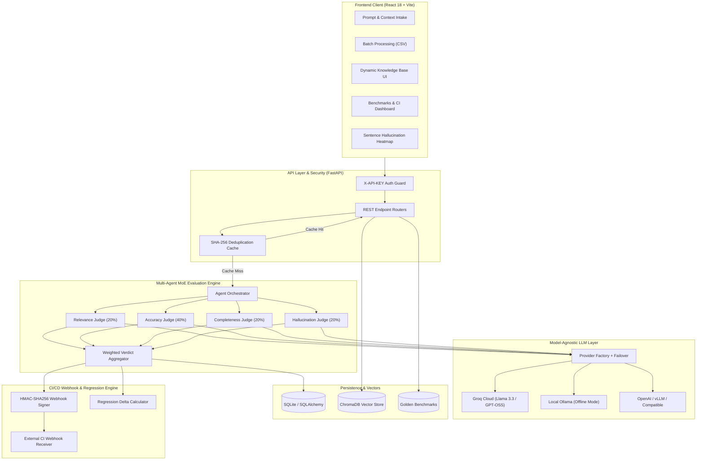

# AI Response Validation System with Hallucination Detection Assistance

<div align="center">

[](https://ai-response-validation-system-ez6e.onrender.com/)
[](https://www.python.org/)
[](https://fastapi.tiangolo.com/)
[](https://react.dev/)
[](https://docs.pytest.org/)
[](https://docs.astral.sh/ruff/)
[](https://www.docker.com/)
[](LICENSE)

**An enterprise-grade, model-agnostic LLM evaluation and hallucination detection platform.**  
*Originally developed as the Capstone Project for **Infosys Springboard Internship 7.0**, and subsequently engineered into a full-scale automated CI/CD regression benchmarking and MLOps validation suite.*

</div>

---

## 🌟 Executive Summary & Architectural Overview

The **AI Response Validation System** is an automated, multi-agent evaluation framework that independently scores and audits AI-generated answers against ground-truth context and reference facts. The system detects factual contradictions, sentence-level hallucinations, topical drift, and missing response facets across multiple LLM providers.



---

## 🚀 The Two Phases of the Project

This codebase represents a two-epoch engineering journey:

```
┌────────────────────────────────────────────────────────┐
│     EPOCH 1: INFOSYS SPRINGBOARD INTERNSHIP 7.0        │
│   Milestones 1–4: Core Foundation & Evaluation Engine  │
└──────────────────────────┬─────────────────────────────┘
                           │
                           ▼
┌────────────────────────────────────────────────────────┐
│      EPOCH 2: POST-INTERNSHIP ENTERPRISE EVOLUTION     │
│   Phases 1–5: Automated Testing, Caching, Multi-LLM,   │
│   Dynamic Knowledge Base & Regression CI/CD Webhooks   │
└────────────────────────────────────────────────────────┘
```

---

## 🏆 Part I: Core Internship Deliverables (Milestones 1–4)

* **Milestone 1 — Research & RAG Scaffolding:** Initial architecture design, evaluation intake form, benchmark dataset ingestion (`TruthfulQA` & `SQuAD`), chunking, embeddings with `sentence-transformers` (`all-MiniLM-L6-v2`), and ChromaDB vector indexing.
* **Milestone 2 — Multi-Agent Evaluation Judges:** Built 3 independent judge agents (Relevance, Accuracy, and Hallucination Detection) running concurrently in a thread-pooled orchestrator.
* **Milestone 3 — Weighted Verdicts & Dual Batch Architecture:** Added the Completeness judge, engineered the composite scoring model (Accuracy 40%, Relevance 20%, Completeness 20%, Hallucination 20%), and introduced a dual-pipeline batch orchestrator with Consolidated Master Prompting to process 50+ row CSVs without hitting API rate limits.
* **Milestone 4 — Visual Dashboards, PDF Reports & Packaging:** Recharts analytics dashboards, browser-native styled PDF validation reports via `jsPDF`, 7 predefined demonstration test cases, and multi-stage single-port Docker containerization on Render.com.

---

## ⚡ Part II: Post-Internship Enterprise Engineering Evolution (Phases 1–5)

To elevate the system from a polished internship prototype into an **enterprise-operable, model-agnostic MLOps platform**, 5 post-internship engineering phases were implemented and verified:

### ⚙️ Phase 1: Automated Test Suite & CI/CD Pipeline
- **Continuous Integration Pipeline ([`.github/workflows/ci.yml`](.github/workflows/ci.yml)):** GitHub Actions workflow executing Ruff linting, test matrices, and container builds on every PR.
- **Automated Test Suite ([`tests/`](tests/)):** Expanded from a single retrieval test to **78 automated pytest tests** covering API endpoints, judge parsing, database queries, and chunking with in-memory SQLite isolation.
- **Ruff Static Analysis:** Zero linting errors across all backend, script, and test code.

### ⚡ Phase 2: Caching Engine & Deduplication
- **Deterministic SHA-256 Hashing ([`backend/core/cache.py`](backend/core/cache.py)):** Generates canonical input hashes across normalized prompt, response, reference, and context.
- **0-Latency Replay Clones:** Evaluates cache hits in milliseconds without making external LLM calls, saving API quota and reducing latency.
- **Telemetry & Cache Analytics:** Real-time cache hit rate tracking integrated into the Analytics Dashboard.

### 🔌 Phase 3: Model-Agnostic Multi-Provider LLM Layer
- **Unified Provider Factory ([`backend/core/providers/factory.py`](backend/core/providers/factory.py)):** Support for:
  - **Groq Cloud:** High-speed cloud inference (`openai/gpt-oss-120b`, `llama-3.3-70b-versatile`).
  - **Ollama:** Local/offline inference (`llama3.2:3b`, `mistral`, etc.) for air-gapped environments.
  - **OpenAI:** OpenAI API or compatible endpoints (vLLM, Together AI, LocalAI).
- **Runtime Failover:** Graceful fallback to `LLM_FALLBACK_PROVIDER` when primary provider retries are exhausted.
- **Provider Status API:** Real-time health endpoint at `GET /api/provider/status`.

### 🗂️ Phase 4: Dynamic Knowledge Base Management UI
- **Full Ingestion Pipeline ([`backend/kb/chunking.py`](backend/kb/chunking.py)):** Sliding-window sentence chunker for PDF, DOCX, TXT, and Markdown files.
- **Management Endpoints:**
  - `GET /api/kb/status`: ChromaDB connection health.
  - `GET /api/kb/documents`: Ingested document catalog with chunk counts.
  - `POST /api/kb/upload`: Direct file upload and vector indexing.
  - `POST /api/kb/search`: Semantic search with cosine similarity distance scoring.
  - `DELETE /api/kb/documents/{doc_id}`: Chunk deletion.
- **Frontend Tab ([`frontend/src/KnowledgeBase.jsx`](frontend/src/KnowledgeBase.jsx)):** Interactive Knowledge Base explorer with drag-and-drop document upload and semantic search playground.

### 🔗 Phase 5: Automated Regression Benchmarking & Webhook CI Integration
- **HMAC-SHA256 Signed Webhooks ([`backend/core/webhook.py`](backend/core/webhook.py)):** `POST /api/evaluate/batch` accepts `callback_url` and `webhook_secret`. Fires signed callbacks (`X-ARVS-Signature: sha256=<hex>`) upon batch completion.
- **Golden Benchmarks & Regression Engine ([`backend/api/benchmark_schemas.py`](backend/api/benchmark_schemas.py)):**
  - Save completed batches as golden baseline benchmarks in `golden_benchmarks` table.
  - `POST /api/benchmarks/{id}/compare`: Evaluates candidate batches against baselines, calculating per-dimension deltas and automated regression verdicts (`REGRESSION_DETECTED` when pass rate drops by >5%, `IMPROVED`, or `STABLE`).
- **Constant-Time API Key Security ([`backend/api/auth.py`](backend/api/auth.py)):** `X-API-KEY` protection against timing attacks (`hmac.compare_digest`).
- **Benchmarks Dashboard ([`frontend/src/Benchmarks.jsx`](frontend/src/Benchmarks.jsx)):** Dedicated "Benchmarks & CI" tab with baseline catalog, comparison runner, and regression delta badges.

---

## 🎨 Interactive Frontend Highlights

* **Interactive Sentence-Level Hallucination Heatmap:** Highlights supported claims in green, extrapolations in amber, and hallucinations in red with bidirectional source document illumination.
* **Real-Time Telemetry & Latency Monitor:** Pulsing header health widget showing live API latency in milliseconds.
* **Smart Batch Risk Filtering:** 1-click filter pills (`⚠️ Hallucinations Only`, `❌ Failed Only`, `✅ Passed Only`) and in-row claim accordion inspector.
* **Configurable Weights Sandbox:** Sliders to adjust Accuracy, Relevance, Completeness, and Hallucination penalty weights globally with real-time recalculation.
* **GitHub-Style Evaluation Calendar:** 365-day density-coded activity heatmap.

---

## 💻 Tech Stack

| Domain | Technologies |
| :--- | :--- |
| **Frontend** | React 18, Vite, Lucide React, Recharts, jsPDF, jspdf-autotable, diff, pure CSS |
| **Backend** | FastAPI, Python 3.12, Uvicorn, Pydantic v2, SQLAlchemy, HTTPX |
| **Database** | SQLite (with WAL mode, composite indexes, and yield-per streaming) |
| **Vector Store & Embeddings** | ChromaDB, Sentence-Transformers (`all-MiniLM-L6-v2`) |
| **LLM Providers** | Groq Cloud, Ollama (Local/Offline), OpenAI / vLLM / Compatible |
| **Testing & Quality** | Pytest (78 tests), Pytest-Cov, Unittest Mock, Ruff Linter, ESLint |
| **DevOps & Packaging** | Docker (Multi-stage build), Docker Compose, GitHub Actions CI |

---

## 🚀 Quickstart & Setup Guide

### 1. Prerequisites & Environment Setup
Clone the repository and copy the environment configuration:
```bash
git clone https://github.com/Hassan092-prog/ai-response-validation-system.git
cd ai-response-validation-system
cp .env.example .env
```
Edit `.env` to configure your preferred LLM provider:
```env
# Choose provider: 'groq' | 'ollama' | 'openai'
LLM_PROVIDER=groq
GROQ_API_KEY=your_groq_api_key_here

# Optional: Failover provider
LLM_FALLBACK_PROVIDER=ollama
OLLAMA_BASE_URL=http://localhost:11434

# Optional: API security key (leave blank for open local dev)
ARVS_API_KEY=
```

---

### 2. Run with Docker (Single Unified Port)
The multi-stage Docker build compiles the React frontend and serves static assets directly via FastAPI on unified port **8005**:
```bash
docker compose up --build -d
```
* **Web Application:** `http://localhost:8005`
* **Swagger API Documentation:** `http://localhost:8005/docs`

---

### 3. Run Manually (Local Development)

#### Terminal 1 — Backend (FastAPI):
```bash
python3 -m venv venv
source venv/bin/activate  # On Windows: venv\Scripts\activate
pip install -r requirements.txt

# Run migrations (if needed)
python scripts/migrate_benchmarks.py

# Start API server
uvicorn backend.api.main:app --host 0.0.0.0 --port 8005 --reload
```

#### Terminal 2 — Frontend (React / Vite):
```bash
cd frontend
npm install
npm run dev
```
* **Frontend Dev Server:** `http://localhost:5173`

---

## 🧪 Testing & Verification

### 1. Run the Automated Test Suite (78 Tests)
```bash
pytest tests/ -v
```
All 78 tests execute in memory with mocked LLM calls and isolated SQLite databases, running in ~14 seconds without consuming API credits:
```text
============================= 78 passed in 14.24s ==============================
```

### 2. Code Linting & Static Analysis
```bash
# Backend linting (Ruff)
ruff check backend/ scripts/ tests/

# Frontend linting (ESLint)
cd frontend && npm run lint
```

---

## 📡 REST API Reference

| Method | Endpoint | Description | Auth |
| :--- | :--- | :--- | :---: |
| `POST` | `/api/evaluate` | Submit single prompt for multi-agent evaluation (with caching) | Optional |
| `POST` | `/api/evaluate/batch` | Upload CSV for batch processing (supports webhooks) | Optional |
| `GET` | `/api/results/{id}` | Retrieve evaluation result by ID | Public |
| `GET` | `/api/batch/{batch_id}` | Poll batch processing progress and completed records | Public |
| `GET` | `/api/evaluations/history` | Paginated evaluation history with KPI stats (alias: `/api/history`) | Public |
| `GET` | `/api/evaluations/analytics` | Aggregated metrics, radar profiles, and time-series (alias: `/api/analytics`) | Public |
| `GET` | `/api/evaluations/export` | Export evaluation records to CSV or JSON | Public |
| `POST` | `/api/extract-text` | Extract text from uploaded PDF, DOCX, or TXT file | Public |
| `GET` | `/api/config/weights` | Get active evaluation dimension weights | Public |
| `POST` | `/api/config/weights` | Globally update scoring penalty weights | Public |
| `GET` | `/api/kb/status` | ChromaDB vector store health status | Public |
| `GET` | `/api/kb/documents` | List ingested documents with chunk counts | Public |
| `POST` | `/api/kb/upload` | Upload and chunk PDF/DOCX/TXT/MD into ChromaDB | Public |
| `POST` | `/api/kb/search` | Semantic vector search with cosine similarity | Public |
| `DELETE` | `/api/kb/documents/{id}` | Delete document and remove chunk embeddings (alias: `/api/kb/{id}`) | Public |
| `POST` | `/api/benchmarks` | Snapshot a completed batch as a Golden Benchmark | `X-API-KEY` |
| `GET` | `/api/benchmarks` | List all saved Golden Benchmarks | `X-API-KEY` |
| `GET` | `/api/benchmarks/{id}` | Retrieve a single Golden Benchmark | `X-API-KEY` |
| `POST` | `/api/benchmarks/{id}/compare` | Compare candidate batch & generate regression delta report | `X-API-KEY` |
| `DELETE` | `/api/benchmarks/{id}` | Delete a Golden Benchmark | `X-API-KEY` |
| `GET` | `/api/provider/status` | Inspect active LLM provider and available models | Public |
| `GET` | `/api/health` | Service health status, active provider, and version check | Public |

---

## 📚 Project Documentation Catalog

All detailed architectural, engineering, and historical records are available in the [`docs/`](docs/) directory:

* 📄 **[Final Project Report](docs/project_report.md):** Academic & technical deep dive covering problem statement, system architecture, MoE scoring models, post-internship enterprise evolution, and evaluation results.
* 🏗️ **[System Architecture](docs/architecture.md):** Detailed architectural diagrams, pipeline specifications, and data flow from ingestion to regression verdicts.
* 📋 **[Agile Scrum Documentation](docs/agile_documentation.md):** Comprehensive agile delivery records across original internship Sprints 1–4 and post-internship enterprise Sprints 5–7 (velocity, burndown, DoD, RTM).
* 🔮 **[Future Scope & Roadmap](docs/Future%20scope%20and%20additions.md):** Analysis of delivered features and strategic roadmap for upcoming initiatives.
* 🔬 **[Research Documentation](docs/research.md):** Theoretical foundation and literature review on hallucination detection, RAG retrieval boundaries, and LLM-as-a-Judge paradigms.

---

## 📄 License

This project is licensed under the **MIT License** — see the [LICENSE](LICENSE) file for details.
