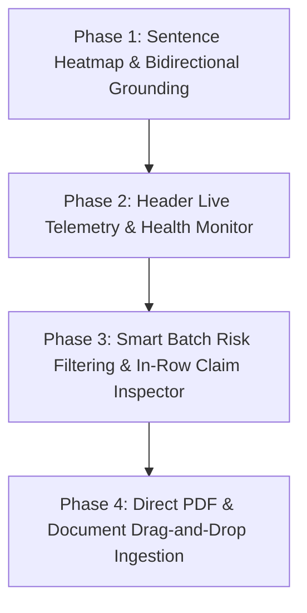

# Future Scope & Feature Additions: AI Response Validation System

> **Document Status:** Finalized Planning & Design Specification (Aligned with Codebase Audit)  
> **Rule Compliance:** *Zero codebase changes made. Only truly missing, high-value, compatible features are included.*

---

## 1. Deep Codebase Audit: What Our Project Already Covers

Before planning any additions, we performed a thorough audit of our existing frontend and backend codebase to avoid duplicate work:

| Analyzed Feature | Codebase Reality & Findings | Verdict |
| :--- | :--- | :--- |
| **Configurable Scoring Weights** | **Already 100% built in our app!** Exists in [`frontend/src/AnalyticsDashboard.jsx:L368-L420`](file:///h:/Documents/Hassan/coding_projects/Infosys%20Springboard%20Internship%207.0/ai-response-validation-system/frontend/src/AnalyticsDashboard.jsx#L368-L420) with interactive sliders and real-time score recalculation, connected to backend endpoints `@app.get("/api/config/weights")` and `@app.post("/api/config/weights")` in [`backend/api/main.py:L62-L69`](file:///h:/Documents/Hassan/coding_projects/Infosys%20Springboard%20Internship%207.0/ai-response-validation-system/backend/api/main.py#L62-L69). | **Excluded (Already Done)** |
| **Test Case Bench** | **Already built!** The `[ 🗄️ Load Test Case 1/7 ]` button in [`frontend/src/App.jsx:L317-L319`](file:///h:/Documents/Hassan/coding_projects/Infosys%20Springboard%20Internship%207.0/ai-response-validation-system/frontend/src/App.jsx#L317-L319) already cycles through 7 curated factual, contradictory, and hallucinated test cases. | **Excluded (Already Done)** |
| **Multi-Vector Grounding Metrics** | Redundant. Handled directly by our specialized **Hallucination** and **Relevance** Judge Agents in [`backend/core/agents/`](file:///h:/Documents/Hassan/coding_projects/Infosys%20Springboard%20Internship%207.0/ai-response-validation-system/backend/core/agents/). | **Excluded (Redundant)** |
| **System Health API** | Backend already provides `@app.get("/api/health")` in [`backend/api/main.py:L57`](file:///h:/Documents/Hassan/coding_projects/Infosys%20Springboard%20Internship%207.0/ai-response-validation-system/backend/api/main.py#L57), returning `{"status": "healthy", "version": "1.0.0"}`. | **Ready for Frontend Hookup** |
| **Claim Flagging Logic** | [`backend/core/agents/hallucination.py:L12-L18`](file:///h:/Documents/Hassan/coding_projects/Infosys%20Springboard%20Internship%207.0/ai-response-validation-system/backend/core/agents/hallucination.py#L12-L18) already prompts the LLM to output `flagged_claims: [{ statement, status, explanation }]`. | **Ready for UI Heatmap** |

---

## 2. Curated High-Value Features Selected for Implementation

Based on user review and architectural fit, the future scope is strictly focused on **4 features** that deliver genuine analytical and workflow value:

```
┌──────────────────────────────────────────────────────────────────────────────────┐
│                             FINALIZED FEATURE SCOPE                              │
├──────────────────────────────────────────────────────────────────────────────────┤
│ 1. Interactive Sentence-Level Hallucination Heatmap with Bidirectional Grounding │
│ 2. Real-Time Telemetry & Header Latency Monitor                                  │
│ 3. Smart Batch Risk Filtering & In-Row Claim Inspector                          │
│ 4. Direct PDF & Text Document Drag-and-Drop Ingestion                            │
└──────────────────────────────────────────────────────────────────────────────────┘
```

---

### Feature 1: Sentence-Level Hallucination Heatmap with Bidirectional Source Grounding
* **Value & Rationale:** Currently, our evaluation output displays overall scores, text reasoning, and a lexical diff. For long responses, users must read paragraphs to find exactly which statement failed and why. This feature transforms the output into an interactive visual heatmap.
* **How It Works:**
  1. The AI response is rendered as discrete sentence spans.
  2. Each sentence is highlighted based on the Hallucination Agent's analysis:
     * **Supported / Grounded:** Subtle emerald tint with green left accent.
     * **Unverified / Extrapolated:** Subtle amber tint (information not grounded in source context).
     * **Hallucination / Contradiction:** Crimson tint with warning badge.
  3. **Bidirectional Source Grounding:**
     * Clicking any highlighted sentence in the AI response illuminates the matching supporting or conflicting sentence in the **Source Document** textarea.
     * An inline inspection card opens below the sentence displaying the agent's exact explanation for that specific claim.
* **Codebase Compatibility:**
  * Uses the existing `flagged_claims` generated by [`backend/core/agents/hallucination.py`](file:///h:/Documents/Hassan/coding_projects/Infosys%20Springboard%20Internship%207.0/ai-response-validation-system/backend/core/agents/hallucination.py).
  * Exposes claims through `generate_verdict()` in [`verdict.py`](file:///h:/Documents/Hassan/coding_projects/Infosys%20Springboard%20Internship%207.0/ai-response-validation-system/backend/core/agents/verdict.py).
  * Rendered cleanly inside [`frontend/src/Results.jsx`](file:///h:/Documents/Hassan/coding_projects/Infosys%20Springboard%20Internship%207.0/ai-response-validation-system/frontend/src/Results.jsx).

---

### Feature 2: Real-Time Telemetry & Header Latency Monitor
* **Value & Rationale:** Provides immediate visibility into backend operational status, active server health, and inference roundtrip latency.
* **How It Works:**
  1. A sleek pill widget in the persistent sidebar/header next to the theme toggle.
  2. **Pulse Dot:** Breathing green dot when online and healthy, shifting to amber during long inference or red if unreachable.
  3. **Latency Tracker:** Shows live roundtrip ping or last evaluation inference time in milliseconds (e.g., `⚡ 142ms`).
  4. **Model Badge:** Quick tooltip indicating backend status (`FastAPI :8005 • Agents Ready`).
* **Codebase Compatibility:**
  * Uses the existing `@app.get("/api/health")` in [`backend/api/main.py:L57`](file:///h:/Documents/Hassan/coding_projects/Infosys%20Springboard%20Internship%207.0/ai-response-validation-system/backend/api/main.py#L57).
  * Light periodic ping (every 15s) in [`frontend/src/App.jsx`](file:///h:/Documents/Hassan/coding_projects/Infosys%20Springboard%20Internship%207.0/ai-response-validation-system/frontend/src/App.jsx).

---

### Feature 3: Smart Batch Risk Filtering & In-Row Claim Inspector
* **Value & Rationale:** When evaluating a batch of 20–50 items, users currently have to scroll through every row to spot failures. Instant risk filtering and in-row claim expansion make batch auditing fast and productive.
* **How It Works:**
  1. **Instant Quick-Filter Buttons above Batch Results Table:**
     * `All Records`
     * `⚠️ Hallucinations Only` (filters to records where Hallucination Agent flagged issues)
     * `❌ Failed Only` (filters to score < 70)
     * `✅ Passed Only`
  2. **In-Row Claim Inspector:**
     * Clicking the expand chevron on any batch row expands an accordion section *directly inside the table*, showing the sentence heatmap and flagged claims for that specific record without leaving the batch view.
* **Codebase Compatibility:**
  * Integrates directly into [`frontend/src/BatchUpload.jsx`](file:///h:/Documents/Hassan/coding_projects/Infosys%20Springboard%20Internship%207.0/ai-response-validation-system/frontend/src/BatchUpload.jsx) and [`frontend/src/BatchAnalyticsView.jsx`](file:///h:/Documents/Hassan/coding_projects/Infosys%20Springboard%20Internship%207.0/ai-response-validation-system/frontend/src/BatchAnalyticsView.jsx).

---

### Feature 4: Direct PDF & Document Drag-and-Drop Ingestion into Source Context
* **Value & Rationale:** Ground truth documents in the real world are almost always PDFs or text files. Having to manually open a PDF, copy text, and paste it into the textarea is tedious.
* **How It Works:**
  1. Users can drag and drop a `.pdf` or `.txt` file directly onto the "Source Document" textarea.
  2. The text is automatically extracted and populated into the field.
  3. Displays a file chip above the textarea (e.g., `📄 policy_manual.pdf • 1,420 words extracted`) with a 1-click "Clear" button.
* **Codebase Compatibility:**
  * Uses client-side lightweight text parsing or an endpoint in [`backend/api/main.py`](file:///h:/Documents/Hassan/coding_projects/Infosys%20Springboard%20Internship%207.0/ai-response-validation-system/backend/api/main.py) to parse file uploads cleanly.
  * Extends the existing `handleFileUpload` function in [`frontend/src/App.jsx:L218`](file:///h:/Documents/Hassan/coding_projects/Infosys%20Springboard%20Internship%207.0/ai-response-validation-system/frontend/src/App.jsx#L218).

---

## 3. Phased Implementation Roadmap



### Implementation Sequence:
1. **Phase 1:** Update `backend/core/agents/verdict.py` to forward `flagged_claims` -> Build `SentenceHeatmap` component in `frontend/src/Results.jsx`.
2. **Phase 2:** Connect `/api/health` in `App.jsx` -> Render real-time latency & pulse telemetry pill in sidebar header.
3. **Phase 3:** Add quick-filter pills and row-level heatmap accordion in `frontend/src/BatchUpload.jsx`.
4. **Phase 4:** Add drag-and-drop PDF/TXT parsing to Source Document in `frontend/src/App.jsx`.

---

> ⚠️ **Status:** Standing by for review. Codebase remains untouched until your instruction.
