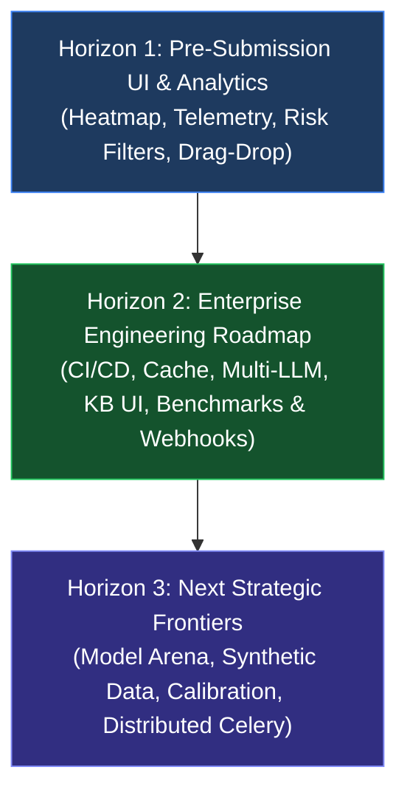

# Future Scope & Feature Roadmap: AI Response Validation System

> **Document Status:** Comprehensive Roadmap & Feature Delivery Ledger  
> **Status:** Horizons 1 & 2 Completed; Horizon 3 Defined  

---

## 1. Feature Delivery Ledger: What Has Been Engineered

To ensure transparency across development epochs, this ledger tracks every feature proposed, planned, and implemented across the system's lifecycle:

| Feature / Capability | Initial Target | Current Status | Delivery Details |
| :--- | :---: | :---: | :--- |
| **Sentence-Level Hallucination Heatmap** | Horizon 1 | **Delivered** | Color-coded sentence spans (green, yellow, red) with bidirectional source illumination in [`Results.jsx`](../frontend/src/Results.jsx). |
| **Real-Time Telemetry & Latency Monitor** | Horizon 1 | **Delivered** | Header telemetry pill displaying backend health and roundtrip inference latency in milliseconds. |
| **Smart Batch Risk Filtering & Accordion** | Horizon 1 | **Delivered** | 1-click filter pills (`⚠️ Hallucinations Only`, `❌ Failed Only`, etc.) and in-row claim accordion in [`BatchUpload.jsx`](../frontend/src/BatchUpload.jsx). |
| **Direct PDF/TXT Drag-and-Drop Ingestion** | Horizon 1 | **Delivered** | Direct file drop zone parsing text files into the Source Document textarea with word-count chips. |
| **Automated Test Suite & GitHub Actions CI** | Horizon 2 | **Delivered** | 76 automated Pytest tests, in-memory SQLite fixtures, Ruff linter, and [`.github/workflows/ci.yml`](../.github/workflows/ci.yml). |
| **SHA-256 Deduplication Caching Engine** | Horizon 2 | **Delivered** | Deterministic SHA-256 input hashing in [`cache.py`](../backend/core/cache.py), $<5\text{ms}$ replay clones, and telemetry tracking. |
| **Model-Agnostic Multi-Provider LLM Layer** | Horizon 2 | **Delivered** | Provider Factory supporting Groq Cloud, local/offline Ollama, OpenAI-compatible APIs, and automatic failover. |
| **Dynamic Knowledge Base Management UI** | Horizon 2 | **Delivered** | ChromaDB document catalog, sentence chunker, and semantic search playground in [`KnowledgeBase.jsx`](../frontend/src/KnowledgeBase.jsx). |
| **Regression Benchmarking & Signed Webhooks** | Horizon 2 | **Delivered** | Golden benchmarks catalog, comparison delta engine, automated regression verdicts, and HMAC-SHA256 signed webhooks. |

---

## 2. Horizon 3: Next Strategic Frontiers

With the core evaluation engine, provider flexibility, caching, and CI/CD benchmarking complete, the following four initiatives represent the next strategic evolutions for the platform:

---

### Feature 1: Model Arena & Head-to-Head Comparative Evaluation
* **Objective:** Allow evaluators to benchmark two distinct LLMs side-by-side on the same prompt and ground truth in real time.
* **Architecture & Workflow:**
  1. Evaluator inputs prompt and optional context, then selects Model A (e.g. `Groq llama-3.3-70b`) and Model B (e.g. `Ollama llama3.2:3b` or `OpenAI gpt-4o-mini`).
  2. Both models generate answers in parallel.
  3. The 4 Judge Agents evaluate both outputs concurrently.
  4. A **Dual Comparison Arena** renders:
     - Side-by-side sentence hallucination heatmaps.
     - Dual radar chart overlay comparing accuracy, relevance, and completeness profiles.
     - Automated Win / Loss / Tie verdict with a consolidated comparative summary.
* **Impact:** Provides empirical decision support for enterprises choosing between open-source self-hosted models and cloud API models.

---

### Feature 2: Synthetic Adversarial Dataset Generator
* **Objective:** Eliminate the manual effort required to construct high-quality evaluation and regression datasets.
* **Architecture & Workflow:**
  1. The user selects an ingested document from the Knowledge Base or provides a domain topic.
  2. An adversarial generator agent uses few-shot prompting to synthesize 10 diverse validation pairs:
     - **Control Cases:** High-accuracy, fully grounded responses.
     - **Subtle Hallucinations:** Fabricates a single plausible statistic, date, or entity.
     - **Inversions & Contradictions:** Inverts a rule or condition stated in the context.
     - **Incomplete Responses:** Omits critical caveats or partial answers.
  3. Evaluators can export the generated dataset directly as CSV or click *"Send to Batch Evaluation"* to stress-test their active evaluation pipeline.
* **Impact:** Enables rapid stress-testing of judge agents and automated pipeline calibration.

---

### Feature 3: LLM-as-a-Judge Calibration & Confusion Matrix
* **Objective:** Quantify the accuracy and agreement of the judge agents against human domain expert feedback.
* **Architecture & Workflow:**
  1. Evaluators can provide "Thumbs Up" or "Thumbs Down" feedback on agent verdicts in the UI.
  2. The system maintains a human feedback dataset alongside LLM verdicts.
  3. An Analytics module calculates:
     - **Precision, Recall, and F1-Score** of the Hallucination Detection Agent against human labels.
     - **Confusion Matrix:** True Positives (correctly flagged hallucinations), False Positives (over-penalized valid responses), False Negatives (missed hallucinations).
  4. Generates recommended prompt adjustments or weight tuning suggestions to improve judge reliability.
* **Impact:** Essential for enterprise compliance and auditing when deploying LLM-as-a-Judge workflows in regulated industries (healthcare, legal, finance).

---

### Feature 4: Distributed Celery & Redis Task Queue for Large Enterprise Batches
* **Objective:** Scale batch evaluation throughput from hundreds of rows to tens of thousands of rows across worker clusters.
* **Architecture & Workflow:**
  1. Replace in-process `BackgroundTasks` with a Celery task queue backed by Redis or RabbitMQ.
  2. Implement distributed rate-limiting buckets per LLM provider to maximize API throughput without hitting TPM/RPM ceilings.
  3. Support paused, resumed, and prioritized batch jobs with real-time SSE (Server-Sent Events) progress streaming to the frontend.
* **Impact:** Positions the platform as a high-throughput enterprise evaluation service capable of processing continuous production inference logs.

---

## 3. Prioritization Matrix

| Initiative | Effort | Technical Risk | Enterprise Impact | Recommended Next Step |
| :--- | :---: | :---: | :---: | :---: |
| **Model Arena (Side-by-Side Comparison)** | 2–3 Days | Low | High | ⭐ **Top Priority** |
| **Synthetic Adversarial Dataset Generator** | 3–4 Days | Medium | High | Second Priority |
| **LLM-as-a-Judge Calibration & Confusion Matrix** | 3 Days | Low | Medium | Third Priority |
| **Distributed Celery / Redis Worker Queue** | 4–5 Days | Medium | High (for scale) | Future Scale |
