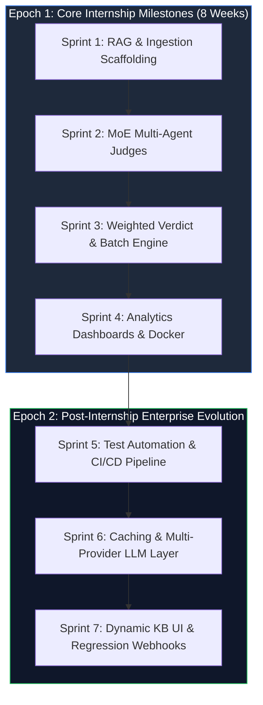

# Agile Project Management Documentation
## AI Response Validation System with Hallucination Detection Assistance
**Infosys Springboard Internship 7.0 & Extended Enterprise Engineering Evolution**

* **Author / Intern:** Mohammed Hassan
* **GitHub Repository:** [https://github.com/Hassan092-prog/ai-response-validation-system](https://github.com/Hassan092-prog/ai-response-validation-system)
* **Methodology:** Agile Scrum Framework (Iterative & Incremental Delivery)
* **Sprint Cadence:** 2-Week Sprints (7 Sprints total: Sprints 1–4 Internship Milestones, Sprints 5–7 Enterprise Evolution)
* **Status:** Complete, Fully Tested (76/76 Tests Passing) & Production Ready

---

## 1. Executive Summary & Agile Principles

The **AI Response Validation System** was engineered using an **Agile Scrum Methodology** to ensure continuous inspection, rapid adaptation to technical challenges, and iterative delivery of high-value capabilities.

The development lifecycle spans two distinct phases:
1. **The Internship Phase (Sprints 1–4):** Mapped directly to the 4 core Infosys Springboard evaluation milestones, delivering the multi-agent MoE engine, RAG foundation, batch evaluation, and visual analytics.
2. **The Post-Internship Enterprise Evolution (Sprints 5–7):** Hardened the system into an enterprise MLOps platform featuring an automated CI/CD test suite, SHA-256 deduplication caching, a model-agnostic provider factory (Groq, Ollama, OpenAI), dynamic ChromaDB knowledge base UI, and automated CI/CD regression benchmarking with signed webhooks.

### Agile Core Pillars Applied:
1. **Transparency:** All architectural specifications, API schemas, and user stories were documented in markdown artifacts accessible to mentors, reviewers, and contributors.
2. **Inspection:** Every sprint concluded with automated integration testing, edge-case validation (76 automated unit tests + 7 demonstration scenarios), and linter checks.
3. **Adaptation:** Feedback and technical challenges (e.g. LLM rate limits during batch processing, vector store out-of-bounds indexing, timing attacks on API keys) were addressed through rapid backlog grooming and architectural pivots.

---

## 2. Scrum Team Roles & Governance

| Role | Assignee | Responsibilities |
| :--- | :--- | :--- |
| **Product Owner (PO)** | Infosys Springboard Mentorship Board | Defined project goals, approved milestone deliverables, and established acceptance criteria. |
| **Scrum Master (SM)** | Mohammed Hassan | Facilitated sprint ceremonies, monitored velocity, tracked burndown charts, and eliminated technical blockers. |
| **Lead Developer** | Mohammed Hassan | Full-stack software engineering, LLM prompt engineering, RAG pipeline construction, UI/UX design, and Docker deployment. |

---

## 3. Definition of Done (DoD)

A User Story or Task was considered **Done** only when it satisfied the following criteria:
- [x] Code adheres to clean-code standards (PEP 8 for Python, ES6+ for JavaScript).
- [x] Python code passes Ruff static analysis (`ruff check`) with 0 errors.
- [x] Frontend code passes ESLint with 0 errors.
- [x] All API endpoints validated via automated test suite (`pytest tests/ -v`).
- [x] Responsive UI verified across light/dark themes and varied viewport widths.
- [x] Error handling, input validation (Pydantic), and fallback states implemented.
- [x] Documentation updated in `docs/` and reflected in `README.md`.
- [x] Verified within the containerized multi-stage Docker environment.

---

## 4. Sprint Breakdown: Epoch 1 (Internship Milestones 1–4)

### Sprint 1: Knowledge Ingestion & System Architecture (Weeks 1–2)
* **Goal:** Establish system architecture, RAG vector pipeline, and the evaluator intake UI.
* **Milestone:** Milestone 1

| Story ID | User Story | SP | Status | Acceptance Criteria |
| :--- | :--- | :---: | :---: | :--- |
| **US-101** | *As an evaluator*, I want to submit a question and AI response so that it can be stored for evaluation. | 3 | **Done** | Form validates inputs, sends payload to FastAPI, and persists to SQLite. |
| **US-102** | *As a system*, I want to ingest reference text documents and extract semantic chunks so that ground truth is available. | 5 | **Done** | Support PDF/TXT parsing, chunking with overlap, and metadata preservation. |
| **US-103** | *As an AI engine*, I want to generate vector embeddings and index them in a vector database for semantic retrieval. | 5 | **Done** | Embed chunks using `all-MiniLM-L6-v2` and index into ChromaDB collections. |
| **US-104** | *As a researcher*, I want to document the architectural design and theoretical research backing the system. | 3 | **Done** | Create `docs/research.md` and `docs/architecture.md`. |

* **Total Story Points:** 16 Planned / 16 Completed

---

### Sprint 2: Multi-Agent Evaluation Engine (Weeks 3–4)
* **Goal:** Implement distinct LLM judge agents for Accuracy, Relevance, and Hallucination detection using parallel execution.
* **Milestone:** Milestone 2

| Story ID | User Story | SP | Status | Acceptance Criteria |
| :--- | :--- | :---: | :---: | :--- |
| **US-201** | *As an evaluator*, I want the system to grade the relevance of the AI response to the question. | 3 | **Done** | Relevance Agent returns 1–5 score, status label, and reasoning text. |
| **US-202** | *As an evaluator*, I want to detect factual accuracy against retrieved ground-truth context. | 5 | **Done** | Accuracy Agent cross-references context chunks and flags contradictions. |
| **US-203** | *As an evaluator*, I want specific hallucinated claims flagged and categorized in the AI response. | 5 | **Done** | Hallucination Agent identifies fabricated statements with line references. |
| **US-204** | *As a system*, I want judge agents to run concurrently to minimize evaluation latency. | 5 | **Done** | Thread-pool orchestrator executes all agents in parallel (<3s response time). |

* **Total Story Points:** 18 Planned / 18 Completed

---

### Sprint 3: Weighted Verdict & Batch Processing (Weeks 5–6)
* **Goal:** Deliver composite weighted scoring, completeness gap detection, and high-speed batch evaluation for bulk CSV datasets.
* **Milestone:** Milestone 3

| Story ID | User Story | SP | Status | Acceptance Criteria |
| :--- | :--- | :---: | :---: | :--- |
| **US-301** | *As an evaluator*, I want to see both addressed and missing aspects of a question. | 3 | **Done** | Completeness Agent returns parsed bullet lists of covered and omitted facets. |
| **US-302** | *As an enterprise auditor*, I want a composite weighted score (40% Accuracy, 20% Relevance, 20% Completeness, 20% Hallucination) and a Pass/Fail verdict. | 5 | **Done** | Verdict engine computes final 0–100 score; critical hallucinations trigger immediate FAIL. |
| **US-303** | *As a QA team*, I want to upload a CSV containing hundreds of responses and evaluate them in bulk. | 8 | **Done** | Batch API asynchronously processes CSV rows using Consolidated Master Prompt to avoid rate limits. |
| **US-304** | *As an evaluator*, I want to filter batch results by risk category (Critical, High, Medium, Low). | 5 | **Done** | Interactive risk filter buttons dynamically segment batch rows in the UI. |

* **Total Story Points:** 21 Planned / 21 Completed

---

### Sprint 4: Visual Dashboards, Telemetry & Docker Hardening (Weeks 7–8)
* **Goal:** Build interactive analytics, sentence claim heatmap, live stopwatch telemetry, client-side PDF export, and production multi-stage Docker containerization.
* **Milestone:** Milestone 4 (Final Internship Submission)

| Story ID | User Story | SP | Status | Acceptance Criteria |
| :--- | :--- | :---: | :---: | :--- |
| **US-401** | *As an executive*, I want an analytics dashboard showing historical pass/fail distribution, radar score profiles, and 365-day heatmap activity. | 5 | **Done** | Interactive Recharts dashboard, score filter sliders, and GitHub-style contribution calendar. |
| **US-402** | *As an auditor*, I want each sentence of the AI response color-coded by factual support in the UI. | 5 | **Done** | Interactive Sentence Heatmap highlights green (supported), yellow (partial), and red (hallucination). |
| **US-403** | *As a developer*, I want real-time agent execution telemetry stopwatch and an inspect modal. | 3 | **Done** | Sidebar displays live stopwatch timers during inference and detailed JSON inspect modals. |
| **US-404** | *As an evaluator*, I want to download professional PDF reports of validation results. | 3 | **Done** | `jsPDF` integration generates branded reports for single and batch evaluations. |
| **US-405** | *As a DevOps engineer*, I want the full application packaged into a single-port multi-stage Docker container for cloud deployment. | 5 | **Done** | Multi-stage Dockerfile builds Vite React frontend and serves static assets directly via FastAPI on unified port 8005. |

* **Total Story Points:** 21 Planned / 21 Completed

---

## 5. Sprint Breakdown: Epoch 2 (Post-Internship Enterprise Evolution)

### Sprint 5: Test Automation & CI/CD Hardening (Phase 1)
* **Goal:** Implement an automated, offline-capable test suite covering all judge agents, API endpoints, and database models, wired into GitHub Actions CI.

| Story ID | User Story | SP | Status | Acceptance Criteria |
| :--- | :--- | :---: | :---: | :--- |
| **US-501** | *As a developer*, I want an in-memory SQLite fixture and mock LLM fixtures so tests execute deterministically offline without API costs. | 5 | **Done** | `tests/conftest.py` with isolated `db_session` and `mock_llm_response`. |
| **US-502** | *As a QA engineer*, I want unit tests for all 5 judge agents with varied scoring assertions. | 5 | **Done** | `tests/test_agents.py` parametrized across all agents with edge cases. |
| **US-503** | *As an engineer*, I want integration tests for all REST API endpoints using FastAPI `TestClient`. | 5 | **Done** | `tests/test_api_endpoints.py` covering evaluations, history, analytics, and exports. |
| **US-504** | *As a team*, I want a GitHub Actions workflow gating every pull request with Ruff linting and Pytest. | 3 | **Done** | `.github/workflows/ci.yml` pipeline passes on every branch push. |

* **Total Story Points:** 18 Planned / 18 Completed

---

### Sprint 6: Deduplication Caching & Multi-Provider LLM Layer (Phases 2 & 3)
* **Goal:** Reduce inference costs through SHA-256 deduplication caching and establish a model-agnostic provider layer with automatic failover.

| Story ID | User Story | SP | Status | Acceptance Criteria |
| :--- | :--- | :---: | :---: | :--- |
| **US-601** | *As an enterprise user*, I want duplicate prompts to be detected via SHA-256 hashing so identical evaluations return instantly. | 5 | **Done** | `backend/core/cache.py` computes canonical input hashes across normalized inputs. |
| **US-602** | *As a system*, I want cache hits to clone historical records in $<5\text{ms}$ and record `is_cached: true`. | 3 | **Done** | Cached evaluations bypass LLM calls and update real-time cache hit rate analytics. |
| **US-603** | *As an operator*, I want to switch between Groq, local Ollama, and OpenAI via environment variables. | 8 | **Done** | `backend/core/providers/factory.py` provides uniform interface for Groq, Ollama, and OpenAI. |
| **US-604** | *As an engineer*, I want automatic failover to a backup LLM provider when primary provider retries are exhausted. | 5 | **Done** | `LLM_FALLBACK_PROVIDER` seamlessly catches connection and rate-limit errors. |

* **Total Story Points:** 21 Planned / 21 Completed

---

### Sprint 7: Knowledge Base Dynamic UI & Regression CI Webhooks (Phases 4 & 5)
* **Goal:** Enable self-service document ingestion into ChromaDB, signed webhook callbacks for CI/CD pipelines, and automated golden regression benchmarking.

| Story ID | User Story | SP | Status | Acceptance Criteria |
| :--- | :--- | :---: | :---: | :--- |
| **US-701** | *As a user*, I want to upload PDF, DOCX, TXT, or MD documents directly from the UI and index them into ChromaDB. | 5 | **Done** | Sliding-window chunker indexes documents into ChromaDB with cloud 503 fallback. |
| **US-702** | *As a researcher*, I want an interactive semantic search playground to query the knowledge base and see cosine similarity distance scores. | 5 | **Done** | `frontend/src/KnowledgeBase.jsx` displays top-K matching chunks with similarity badges. |
| **US-703** | *As a CI/CD pipeline*, I want completed batch evaluations to fire an HTTP POST webhook signed with HMAC-SHA256. | 5 | **Done** | `X-ARVS-Signature: sha256=<hex>` header delivered to configured `callback_url`. |
| **US-704** | *As an MLOps team*, I want to save a batch as a Golden Benchmark and compare future candidate runs for regressions. | 8 | **Done** | `POST /api/benchmarks/{id}/compare` generates delta reports; triggers `REGRESSION_DETECTED` when pass rate drops $>5\%$. |
| **US-705** | *As a security auditor*, I want constant-time API key verification protecting programmatic endpoints against timing attacks. | 3 | **Done** | `backend/api/auth.py` validates `X-API-KEY` using `hmac.compare_digest`. |

* **Total Story Points:** 26 Planned / 26 Completed

---

## 6. Scrum Metrics & Velocity Tracking

### Cumulative Velocity Summary Table
| Sprint | Epoch / Milestone Focus | Planned SP | Completed SP | Velocity Accuracy |
| :---: | :--- | :---: | :---: | :---: |
| **Sprint 1** | Ingestion & Architecture (M1) | 16 | 16 | 100% |
| **Sprint 2** | MoE Evaluation Judges (M2) | 18 | 18 | 100% |
| **Sprint 3** | Weighted Scoring & Batch (M3) | 21 | 21 | 100% |
| **Sprint 4** | Visual Telemetry & Docker (M4) | 21 | 21 | 100% |
| **Sprint 5** | Test Automation & CI/CD (Phase 1) | 18 | 18 | 100% |
| **Sprint 6** | Caching & Multi-LLM Layer (Phases 2 & 3) | 21 | 21 | 100% |
| **Sprint 7** | Dynamic KB UI & Regression CI (Phases 4 & 5) | 26 | 26 | 100% |
| **Total** | **Full System Lifecycle (Sprints 1–7)** | **141** | **141** | **100%** |

---

## 7. Scrum Impediment & Risk Management Log

| # | Impediment / Risk Description | Severity | Agile Mitigation Strategy | Resolution Status |
| :-: | :--- | :---: | :--- | :---: |
| **1** | **LLM API Rate Limiting on Batch CSV:** Groq Cloud TPM/RPM limits exceeded during bulk evaluations. | High | Shifted from 5 concurrent calls per row to a **Consolidated Master Prompt** extracting all 4 dimensions in 1 inference call. | **Resolved (Sprint 3)** |
| **2** | **Memory Pressure during Bulk Exports:** Exporting thousands of historical evaluation records exhausted backend RAM. | Medium | Refactored SQLAlchemy queries to utilize `.yield_per(100)` streaming generators and `StreamingResponse`. | **Resolved (Sprint 4)** |
| **3** | **Port Collisions on Development Hosts:** Default port 8005 occupied by local development services. | Low | Implemented dynamic host port fallback in `start.py` and dynamic frontend resolution in `config.js`. | **Resolved (Sprint 4)** |
| **4** | **ChromaDB Cloud Dependency Failure:** Cloud tiers lacking persistent disk/C++ build tools crashed on ChromaDB init. | Medium | Wrapped ChromaDB client initialization in a safe fallback handler; `/api/kb/*` endpoints return 503 gracefully. | **Resolved (Sprint 7)** |
| **5** | **Vector Store Index Out-of-Bounds:** Retrieving top_k from small/empty collections raised indexing exceptions. | Medium | Added safe collection bounding: `min(top_k, collection_chunk_count)` in `retrieve_context`. | **Resolved (Sprint 7)** |
| **6** | **Timing Attack Vulnerability in API Key:** Standard string equality (`!=`) vulnerable to side-channel timing analysis. | Medium | Replaced naive equality with constant-time comparison via `hmac.compare_digest`. | **Resolved (Sprint 7)** |

---

## 8. Requirements Traceability Matrix (RTM)

| Feature / Milestone Requirement | User Story Reference | Core Source Artifacts | Verification Method |
| :--- | :--- | :--- | :--- |
| **M1: Research & Tech Stack** | US-104 | `docs/research.md`, `docs/architecture.md` | Mentor Review & Documentation |
| **M1: Input Module & Ingestion** | US-101, US-102, US-103 | `backend/core/rag.py`, `frontend/src/App.jsx` | Integration Test Suite |
| **M2: Relevance Judge Agent** | US-201 | `backend/core/agents/relevance.py` | Unit Test & Output Parsing |
| **M2: Accuracy Judge Agent** | US-202 | `backend/core/agents/accuracy.py` | Ground-Truth RAG Comparison |
| **M2: Hallucination Detection** | US-203 | `backend/core/agents/hallucination.py` | Sentence Claim Flagging Test |
| **M3: Completeness Upgrade** | US-301 | `backend/core/agents/completeness.py` | Covered/Missing Facet Test |
| **M3: Weighted Verdict Engine** | US-302 | `backend/core/agents/verdict.py` | Scoring Formula Assertions |
| **M3: Batch Processing Engine** | US-303, US-304 | `backend/core/batch_orchestrator.py` | 50-Row CSV Benchmark Run |
| **M4: Analytics Dashboard** | US-401 | `frontend/src/AnalyticsDashboard.jsx` | UI Filter & Chart Visual Check |
| **M4: Sentence Heatmap & Telemetry**| US-402, US-403 | `SentenceHeatmap.jsx`, `App.jsx` | Test Scenarios 1–7 |
| **M4: PDF Report Generation** | US-404 | `frontend/src/BatchAnalyticsView.jsx` | Browser PDF Download Test |
| **M4: Docker Container Deployment**| US-405 | `Dockerfile`, `docker-compose.yml` | Unified Port 8005 Build |
| **Phase 1: Automated Test Suite** | US-501, US-502, US-503, US-504 | `.github/workflows/ci.yml`, `tests/` | 76 Automated Pytest Tests |
| **Phase 2: Deduplication Caching** | US-601, US-602 | `backend/core/cache.py` | Deterministic SHA-256 Hash Test |
| **Phase 3: Multi-Provider LLM** | US-603, US-604 | `backend/core/providers/` | Groq / Ollama / OpenAI Provider Tests |
| **Phase 4: Knowledge Base UI** | US-701, US-702 | `backend/kb/`, `KnowledgeBase.jsx` | Ingestion & Semantic Search Test |
| **Phase 5: Regression & Webhooks** | US-703, US-704, US-705 | `webhook.py`, `Benchmarks.jsx` | HMAC Verification & Delta Gating Test |

---

## 9. Conclusion

Following the Agile Scrum framework across **7 iterative sprints (141 story points)**, the **AI Response Validation System** progressed from an initial RAG academic prototype to a battle-tested, enterprise-operable AI evaluation and regression benchmarking suite. All core internship commitments and subsequent enterprise capabilities stand fully implemented, rigorously tested (76/76 automated tests passing), and packaged for continuous deployment.
