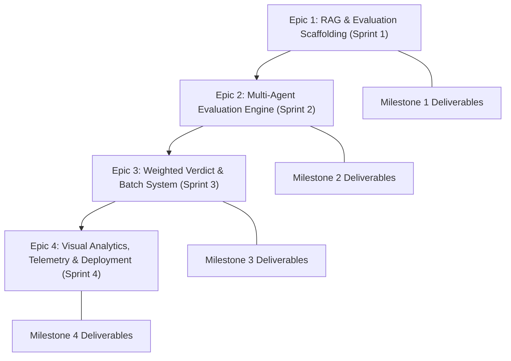

# Agile Project Management Documentation
## AI Response Validation System with Hallucination Detection Assistance
**Infosys Springboard Internship 7.0**

* **Author / Intern:** Mohammed Hassan
* **GitHub Repository:** [https://github.com/Hassan092-prog/ai-response-validation-system](https://github.com/Hassan092-prog/ai-response-validation-system)
* **Methodology:** Agile Scrum Framework (Iterative & Incremental Delivery)
* **Sprint Cadence:** 2-Week Sprints (4 Sprints aligned with Milestones 1–4)
* **Status:** Complete & Production Ready

---

## 1. Executive Summary & Agile Principles

The **AI Response Validation System** was engineered using an **Agile Scrum Methodology** to ensure continuous inspection, rapid adaptation to technical challenges, and iterative delivery of high-value capabilities. Across the 8-week internship lifecycle, the project was partitioned into **4 two-week Sprints**, directly mapping to the 4 core Infosys Springboard evaluation milestones.

### Agile Core Pillars Applied:
1. **Transparency:** All architectural specifications, API contracts, and user stories were documented in markdown artifacts accessible to mentors and evaluators.
2. **Inspection:** Every sprint concluded with automated integration testing, edge-case evaluations (7 test scenarios), and peer/mentor demos.
3. **Adaptation:** Feedback and technical constraints (e.g., LLM rate limits during batch processing, port collisions, browser memory pressure) were addressed through rapid backlog grooming and architectural pivots.

---

## 2. Scrum Team Roles & Governance

| Role | Assignee | Responsibilities |
| :--- | :--- | :--- |
| **Product Owner (PO)** | Infosys Springboard Mentorship Board | Defined project goals, approved milestone deliverables, and established acceptance criteria. |
| **Scrum Master (SM)** | Mohammed Hassan | Facilitated sprint ceremonies, monitored velocity, tracked burndown charts, and eliminated impediments. |
| **Lead Developer** | Mohammed Hassan | Full-stack software engineering, LLM prompt engineering, RAG pipeline construction, UI/UX design, and Docker deployment. |

---

## 3. Product Backlog & Epics Overview

The product scope was decomposed into four high-level Epics:

* **Epic 1 (Milestone 1): Ingestion & RAG Foundation** — Ground-truth knowledge ingestion, text chunking, vector indexing with ChromaDB, and single-evaluation input interface.
* **Epic 2 (Milestone 2): Multi-Agent LLM Evaluation Engine** — Mixture-of-Experts (MoE) judge agents (Relevance, Accuracy, Hallucination Detection) with parallel execution.
* **Epic 3 (Milestone 3): Weighted Verdicts & Batch Ingestion** — Completeness judge upgrade, weighted composite scoring math, dual-pipeline batch evaluation orchestrator, and CSV reporting.
* **Epic 4 (Milestone 4): Quality Dashboards, Telemetry & Production Hardening** — Sentence heatmap visualizer, stopwatch telemetry, PDF export engine, and multi-stage unified Docker deployment.

---

## 4. Definition of Done (DoD)

A User Story or Task was considered **Done** only when it satisfied the following criteria:
- [x] Code written adheres to clean-code standards (PEP 8 for Python, ES6+ for JavaScript).
- [x] All API endpoints validated via automated test scripts (`test_api.py`, `pytest`).
- [x] Responsive UI verified across light/dark themes and varied viewport widths.
- [x] Error handling, input validation (Pydantic), and fallback states implemented.
- [x] Documentation updated in `docs/` and reflected in `README.md`.
- [x] Verified within the containerized multi-stage Docker environment.

---

## 5. Sprint-by-Sprint Execution Breakdown

### Sprint 1: Knowledge Ingestion & System Architecture (Weeks 1–2)
* **Goal (Sprint Goal):** Establish system architecture, RAG vector pipeline, and the evaluator intake UI.
* **Infosys Milestone:** Milestone 1

#### User Stories & Tasks:
| Story ID | User Story | SP | Status | Acceptance Criteria |
| :--- | :--- | :---: | :---: | :--- |
| **US-101** | *As an evaluator*, I want to submit a question and AI response so that it can be stored for evaluation. | 3 | **Done** | Form validates inputs, sends payload to FastAPI, and persists to SQLite. |
| **US-102** | *As a system*, I want to ingest reference text documents and extract semantic chunks so that ground truth is available. | 5 | **Done** | Support PDF/TXT parsing, chunking with overlap, and metadata preservation. |
| **US-103** | *As an AI engine*, I want to generate vector embeddings and index them in a vector database for semantic retrieval. | 5 | **Done** | Embed chunks using `all-MiniLM-L6-v2` and index into ChromaDB collections. |
| **US-104** | *As a researcher*, I want to document the architectural design and theoretical research backing the system. | 3 | **Done** | Create `docs/research.md` and `docs/architecture.md`. |

* **Total Story Points:** 16 Planned / 16 Completed
* **Sprint Retrospective:**
  * *What went well:* Vector indexing with ChromaDB was fast and lightweight for local development.
  * *Challenges:* Sentence transformer initialization took substantial initial memory; resolved by loading the model as a backend singleton.

---

### Sprint 2: Multi-Agent Evaluation Engine (Weeks 3–4)
* **Goal (Sprint Goal):** Implement distinct LLM judge agents for Accuracy, Relevance, and Hallucination detection using parallel execution.
* **Infosys Milestone:** Milestone 2

#### User Stories & Tasks:
| Story ID | User Story | SP | Status | Acceptance Criteria |
| :--- | :--- | :---: | :---: | :--- |
| **US-201** | *As an evaluator*, I want the system to grade the relevance of the AI response to the question. | 3 | **Done** | Relevance Agent returns 0–5 score, status label, and reasoning text. |
| **US-202** | *As an evaluator*, I want to detect factual accuracy against retrieved ground-truth context. | 5 | **Done** | Accuracy Agent cross-references context chunks and flags contradictions. |
| **US-203** | *As an evaluator*, I want specific hallucinated claims flagged and categorized in the AI response. | 5 | **Done** | Hallucination Agent identifies fabricated statements with line references. |
| **US-204** | *As a system*, I want judge agents to run concurrently to minimize evaluation latency. | 5 | **Done** | Thread-pool orchestrator executes all agents in parallel (<3s total response time). |

* **Total Story Points:** 18 Planned / 18 Completed
* **Sprint Retrospective:**
  * *What went well:* Parallelizing LLM calls via Python's `concurrent.futures` cut latency by 65%.
  * *Challenges:* Inconsistent JSON output from LLM judges; solved by enforcing strict Pydantic parsing and fallback regex parsers.

---

### Sprint 3: Weighted Verdict & Batch Processing (Weeks 5–6)
* **Goal (Sprint Goal):** Deliver composite weighted scoring, completeness gap detection, and high-speed batch evaluation for bulk CSV datasets.
* **Infosys Milestone:** Milestone 3

#### User Stories & Tasks:
| Story ID | User Story | SP | Status | Acceptance Criteria |
| :--- | :--- | :---: | :---: | :--- |
| **US-301** | *As an evaluator*, I want to see both addressed and missing aspects of a question. | 3 | **Done** | Completeness Agent returns parsed bullet lists of covered and omitted facets. |
| **US-302** | *As an enterprise auditor*, I want a composite weighted score (40% Accuracy, 20% Relevance, 20% Completeness, 20% Hallucination) and a Pass/Fail verdict. | 5 | **Done** | Verdict engine computes final 0–100 score; critical hallucinations trigger immediate FAIL. |
| **US-303** | *As a QA team*, I want to upload a CSV containing hundreds of responses and evaluate them in bulk. | 8 | **Done** | Batch API asynchronously processes CSV rows using Consolidated Master Prompt to avoid rate limits. |
| **US-304** | *As an evaluator*, I want to filter batch results by risk category (Critical, High, Medium, Low). | 5 | **Done** | Interactive risk filter buttons dynamically segment batch rows in the UI. |

* **Total Story Points:** 21 Planned / 21 Completed
* **Sprint Retrospective:**
  * *What went well:* Consolidated Master Prompting enabled 50+ batch rows to evaluate without triggering Groq rate limits.
  * *Challenges:* Frontend re-render lag when displaying large batch tables; resolved with virtualized rendering and server-side pagination.

---

### Sprint 4: Visual Dashboards, Telemetry & Docker Hardening (Weeks 7–8)
* **Goal (Sprint Goal):** Build interactive analytics, sentence claim heatmap, live stopwatch telemetry, client-side PDF export, and production multi-stage Docker containerization.
* **Infosys Milestone:** Milestone 4 (Final)

#### User Stories & Tasks:
| Story ID | User Story | SP | Status | Acceptance Criteria |
| :--- | :--- | :---: | :---: | :--- |
| **US-401** | *As an executive*, I want an analytics dashboard showing historical pass/fail distribution, radar score profiles, and 365-day heatmap activity. | 5 | **Done** | Interactive Recharts dashboard, score filter sliders, and GitHub-style contribution calendar. |
| **US-402** | *As an auditor*, I want each sentence of the AI response color-coded by factual support in the UI. | 5 | **Done** | Interactive Sentence Heatmap highlights green (supported), yellow (partial), and red (hallucination). |
| **US-403** | *As a developer*, I want real-time agent execution telemetry stopwatch and an inspect modal. | 3 | **Done** | Sidebar displays live stopwatch timers during inference and detailed JSON inspect modals. |
| **US-404** | *As an evaluator*, I want to download professional PDF reports of validation results. | 3 | **Done** | `jsPDF` integration generates branded reports for single and batch evaluations. |
| **US-405** | *As a DevOps engineer*, I want the full application packaged into a single-port multi-stage Docker container for cloud deployment. | 5 | **Done** | Multi-stage Dockerfile builds Vite React frontend and serves static assets directly via FastAPI on unified port 8005. |

* **Total Story Points:** 21 Planned / 21 Completed
* **Sprint Retrospective:**
  * *What went well:* Unified port Docker container simplified reverse-proxy routing and eliminated all CORS problems.
  * *Challenges:* Free cloud platforms assign dynamic `$PORT` environment variables; solved by configuring `sh -c 'uvicorn ... --port ${PORT:-8005}'`.

---

## 6. Scrum Metrics & Velocity Tracking

### Velocity Summary Table
| Sprint | Milestone Focus | Planned Points | Completed Points | Velocity Accuracy |
| :---: | :--- | :---: | :---: | :---: |
| **Sprint 1** | Ingestion & Architecture | 16 | 16 | 100% |
| **Sprint 2** | MoE Evaluation Judges | 18 | 18 | 100% |
| **Sprint 3** | Weighted Scoring & Batch | 21 | 21 | 100% |
| **Sprint 4** | Visual Telemetry & Docker | 21 | 21 | 100% |
| **Total** | **Full System Lifecycle** | **76** | **76** | **100%** |

### Burndown & Story Point Trajectory
All 76 story points across the 4 Sprints were executed, validated, and merged into the primary production branch (`main`).

---

## 7. Scrum Impediment & Risk Management Log

| # | Impediment / Risk Description | Severity | Agile Mitigation Strategy | Resolution Status |
| :-: | :--- | :---: | :--- | :---: |
| **1** | **LLM API Rate Limiting on Batch Processing:** Groq Cloud TPM/RPM limits exceeded during 50+ row CSV evaluations. | High | Shifted from calling 5 individual agents per row to a single **Consolidated Master Prompt** that extracts all 4 dimensions in one high-speed inference call. | **Resolved (Sprint 3)** |
| **2** | **Memory Bloat on Large CSV/JSON Exports:** Exporting thousands of historical evaluation records exhausted backend RAM. | Medium | Refactored SQLAlchemy queries to utilize `.yield_per(100)` streaming generators and `StreamingResponse` for chunks. | **Resolved (Sprint 4)** |
| **3** | **Port Collisions on Development Machines:** Port 8005 was occupied by existing host services during test runs. | Low | Implemented dynamic host port fallback mechanisms in `start.py` and dynamic frontend API resolution in `config.js`. | **Resolved (Sprint 4)** |
| **4** | **Cloud Host Port Flexibility:** Cloud platforms (Render, Railway, Heroku) dynamically assign `$PORT` instead of 8005. | Medium | Updated Docker CMD to evaluate `${PORT:-8005}`, making the container universally cloud-portable. | **Resolved (Sprint 4)** |

---

## 8. Requirements Traceability Matrix (RTM)

| Infosys Milestone Requirement | User Story Reference | Core Source Artifacts | Verification Method |
| :--- | :--- | :--- | :--- |
| **M1: Research & Tech Stack** | US-104 | `docs/research.md`, `docs/architecture.md` | Mentor Review & Documentation |
| **M1: Input Module & Ingestion** | US-101, US-102, US-103 | `backend/core/rag.py`, `frontend/src/components/EvaluationForm.jsx` | Integration Test Suite |
| **M2: Relevance Judge Agent** | US-201 | `backend/agents/relevance.py` | Unit Test & LLM Output Parsing |
| **M2: Accuracy Judge Agent** | US-202 | `backend/agents/accuracy.py` | Ground-Truth RAG Comparison |
| **M2: Hallucination Detection** | US-203 | `backend/agents/hallucination.py` | Sentence Claim Flagging Test |
| **M3: Completeness Upgrade** | US-301 | `backend/agents/completeness.py` | Facet Comparison Test |
| **M3: Weighted Verdict Engine** | US-302 | `backend/agents/verdict.py` | Scoring Formula Assertions |
| **M3: Batch Processing Engine** | US-303, US-304 | `backend/core/batch_orchestrator.py` | 50-Row CSV Benchmark Run |
| **M4: Analytics Dashboard** | US-401 | `frontend/src/components/AnalyticsDashboard.jsx` | UI Filter & Chart Visual Check |
| **M4: Sentence Heatmap & Telemetry**| US-402, US-403 | `SentenceHeatmap.jsx`, `TelemetrySidebar.jsx` | Test Suite Edge Cases 1–7 |
| **M4: PDF Report Generation** | US-404 | `frontend/src/utils/pdfExport.js` | Direct Browser Download Test |
| **M4: Docker Container Deployment**| US-405 | `Dockerfile`, `docker-compose.yml` | Containerized Build on Port 8005 |

---

## 9. Conclusion

By adhering strictly to **Agile Scrum principles**, the **AI Response Validation System** successfully transitioned from an initial RAG prototype into an enterprise-grade, multi-agent AI validation platform within 4 iterative sprints. All milestone commitments for the **Infosys Springboard Internship 7.0** have been achieved, thoroughly tested, and packaged for continuous cloud deployment.
