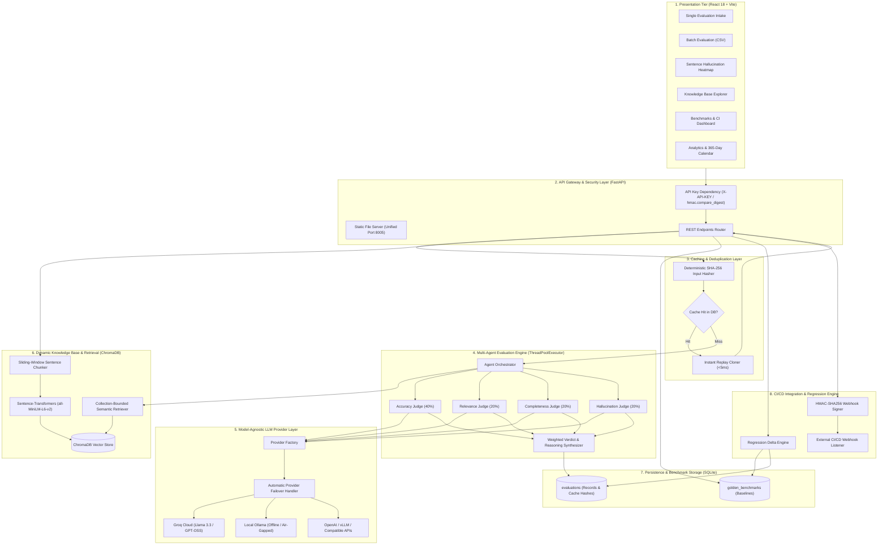

# System Architecture: AI Response Validation System

> **Document Type:** System Architecture & Technical Design Specification  
> **Target Project:** Infosys Springboard Internship 7.0 & Extended Enterprise MLOps Suite  
> **Status:** Production-Ready & Enterprise-Operable  

---

## 1. High-Level Architecture Diagram

The system employs a decoupled, asynchronous, multi-agent architecture with a model-agnostic provider layer, deduplication caching, dynamic vector retrieval, and automated CI/CD regression benchmarking:



---

## 2. Core Subsystems & Components

### 2.1 Presentation Tier (React 18 + Vite)
- **Framework:** React 18, Vite bundling, pure CSS glassmorphism, Lucide React icons, and Recharts.
- **Single Evaluation Tab:** Evaluation form with drag-and-drop file ingestion, 7 demonstration edge cases, sentence heatmap, and live telemetry.
- **Batch Processing Tab:** Multi-row CSV uploader with quick risk filter pills (`⚠️ Hallucinations Only`, `❌ Failed Only`, `✅ Passed Only`), in-row claim accordion inspector, and expandable Webhook CI configuration.
- **Knowledge Base Tab:** Drag-and-drop PDF/DOCX/TXT/MD document indexing, live chunk counter, and semantic search playground.
- **Benchmarks & CI Tab:** Golden benchmark baseline catalog, candidate batch comparison runner, and color-coded regression delta reports.
- **Analytics Dashboard:** Time-series charts, radar score profiles, 365-day contribution calendar, and real-time configurable penalty weight sliders.

### 2.2 API Gateway & Security Layer (FastAPI)
- **FastAPI Core:** High-performance async ASGI server with CORS middleware.
- **Constant-Time Authentication ([`backend/api/auth.py`](../backend/api/auth.py)):** Validates `X-API-KEY` against `ARVS_API_KEY` using `hmac.compare_digest` to eliminate timing attack vulnerabilities. Open and unrestricted when `ARVS_API_KEY` is blank (local development mode).
- **Unified Port Delivery:** In production Docker environments, FastAPI mounts the compiled React distribution at `/`, serving the API and UI simultaneously on port **8005**.

### 2.3 SHA-256 Deduplication & Caching Engine ([`backend/core/cache.py`](../backend/core/cache.py))
- **Normalization:** Cleans leading/trailing whitespace, collapses internal whitespace, and lowercases text.
- **Hash Generation:** Computes deterministic SHA-256 digest across:
  $$\text{Input Hash} = \text{SHA256}(\text{norm}(Q) \,\|\, \text{norm}(A) \,\|\, \text{norm}(R) \,\|\, \text{norm}(C))$$
- **Instant Replay:** Cache hits return cloned evaluations in $<5\text{ms}$ with `is_cached: true`, conserving API quotas and rate limits.
- **Telemetry:** Real-time `cache_hit_rate` percentage tracked in analytics.

### 2.4 Multi-Agent Mixture of Experts (MoE) Orchestrator
- **ThreadPool Parallelism:** Executes Relevance, Accuracy, Completeness, and Hallucination agents concurrently via `concurrent.futures.ThreadPoolExecutor`.
- **Relevance Judge Agent ([`backend/core/agents/relevance.py`](../backend/core/agents/relevance.py)):** Evaluates prompt adherence (1–5 score).
- **Accuracy Judge Agent ([`backend/core/agents/accuracy.py`](../backend/core/agents/accuracy.py)):** Validates factual claims against reference text and retrieved context (1–5 score).
- **Completeness Judge Agent ([`backend/core/agents/completeness.py`](../backend/core/agents/completeness.py)):** Extracts covered and missing aspects (1–5 score).
- **Hallucination Detection Agent ([`backend/core/agents/hallucination.py`](../backend/core/agents/hallucination.py)):** Cross-references each discrete claim against context, outputting line-item flagged claims (1–5 score, where 5 = zero hallucination).
- **Verdict Agent ([`backend/core/agents/verdict.py`](../backend/core/agents/verdict.py)):** Aggregates agent scores using the weighted formula and generates an executive summary.
- **Consolidated Batch Orchestrator ([`backend/core/batch_orchestrator.py`](../backend/core/batch_orchestrator.py)):** High-speed batch pipeline leveraging a single Consolidated Master Prompt to process 50+ CSV rows without triggering provider rate limits.

### 2.5 Model-Agnostic LLM Provider Layer ([`backend/core/providers/`](../backend/core/providers/))
- **Uniform Base Provider ([`backend/core/providers/base.py`](../backend/core/providers/base.py)):** Standard interface for JSON LLM calls with automated markdown sanitization and parsing.
- **Groq Cloud Provider ([`backend/core/providers/groq_provider.py`](../backend/core/providers/groq_provider.py)):** High-speed cloud inference via Groq SDK (`openai/gpt-oss-120b`, `llama-3.3-70b-versatile`).
- **Ollama Provider ([`backend/core/providers/ollama_provider.py`](../backend/core/providers/ollama_provider.py)):** Local/offline inference via Ollama HTTP API for air-gapped environments.
- **OpenAI Provider ([`backend/core/providers/openai_provider.py`](../backend/core/providers/openai_provider.py)):** OpenAI API or compatible endpoints (vLLM, Together AI, LocalAI).
- **Failover Mechanism:** Attempts secondary calls on `LLM_FALLBACK_PROVIDER` if the primary provider encounters unrecoverable connection errors.

### 2.6 Dynamic Knowledge Base & Retrieval (ChromaDB)
- **Document Chunking ([`backend/kb/chunking.py`](../backend/kb/chunking.py)):** Sliding-window sentence chunker (500 characters, 50 character overlap) preserving sentence boundaries.
- **Embeddings:** Local vectorization using `sentence-transformers/all-MiniLM-L6-v2` (384-dimensional dense vectors).
- **Safe Boundary Retrieval:** Binds retrieval queries to `min(top_k, collection_chunk_count)` to prevent ChromaDB index out-of-bounds exceptions.

### 2.7 Regression Benchmarking & Webhook CI Engine
- **Signed Webhook Delivery ([`backend/core/webhook.py`](../backend/core/webhook.py)):** Generates HMAC-SHA256 signatures (`X-ARVS-Signature: sha256=<hex>`) sent to configured `callback_url` upon batch completion.
- **Golden Benchmarks Catalog ([`backend/api/models.py`](../backend/api/models.py)):** Stores baseline metrics in `golden_benchmarks` table.
- **Delta Comparison Runner:** Computes absolute and percentage changes across Accuracy, Relevance, Completeness, Hallucination, and Pass Rate.
- **Automated Gating:** Returns `REGRESSION_DETECTED` when pass rate drops by $>5$ percentage points or key quality metrics degrade.

---

## 3. Database Schema Architecture

```text
┌─────────────────────────────────────────┐       ┌─────────────────────────────────────────┐
│              evaluations                │       │            golden_benchmarks            │
├─────────────────────────────────────────┤       ├─────────────────────────────────────────┤
│ id (INTEGER, PK, Auto-Inc)              │       │ id (INTEGER, PK, Auto-Inc)              │
│ question (TEXT)                         │       │ name (VARCHAR(120), UNIQUE, Index)      │
│ ai_response (TEXT)                      │       │ description (TEXT, Nullable)            │
│ reference_answer (TEXT, Nullable)       │       │ batch_id (VARCHAR(36), Index)           │
│ source_document (TEXT, Nullable)        │       │ total_records (INTEGER)                 │
│ final_score (FLOAT, Index)              │       │ pass_rate (FLOAT)                       │
│ verdict (VARCHAR(50))                   │       │ avg_final_score (FLOAT)                 │
│ status (VARCHAR(20), Index)             │       │ avg_accuracy (FLOAT)                    │
│ is_cached (BOOLEAN, Index)              │       │ avg_relevance (FLOAT)                   │
│ input_hash (VARCHAR(64), Index)         │       │ avg_completeness (FLOAT)                │
│ batch_id (VARCHAR(36), Index, Nullable) │       │ avg_hallucination (FLOAT)               │
│ batch_webhook_url (TEXT, Nullable)      │       │ created_at (DATETIME, Index)            │
│ batch_webhook_secret_hash (VARCHAR(64)) │       └─────────────────────────────────────────┘
│ created_at (DATETIME, Index)            │
└─────────────────────────────────────────┘
```

---

## 4. REST API Endpoint Reference

| Category | Method | Path | Description | Security |
| :--- | :--- | :--- | :--- | :---: |
| **Evaluations** | `POST` | `/api/evaluate` | Submit single prompt for multi-agent evaluation | Optional |
| | `POST` | `/api/evaluate/batch` | Upload CSV for background batch evaluation | Optional |
| | `GET` | `/api/results/{id}` | Retrieve evaluation record by ID | Public |
| | `GET` | `/api/batch/{batch_id}` | Poll batch evaluation progress & completed records | Public |
| **Analytics** | `GET` | `/api/evaluations/history` | Paginated evaluation history with KPI stats (alias: `/api/history`) | Public |
| | `GET` | `/api/evaluations/analytics` | Aggregated metrics, radar profiles & time series (alias: `/api/analytics`) | Public |
| | `GET` | `/api/evaluations/export` | Stream evaluation records in CSV or JSON format | Public |
| | `POST` | `/api/extract-text` | Extract text from uploaded PDF, DOCX, or TXT file | Public |
| | `GET` | `/api/config/weights` | Read active scoring penalty weights | Public |
| | `POST` | `/api/config/weights` | Globally update scoring penalty weights | Public |
| **Knowledge Base** | `GET` | `/api/kb/status` | Vector store health & chunk stats (503 on cloud) | Public |
| | `GET` | `/api/kb/documents` | Catalog of ingested source documents | Public |
| | `POST` | `/api/kb/upload` | Ingest and chunk PDF/DOCX/TXT/MD files | Public |
| | `POST` | `/api/kb/search` | Semantic search with cosine similarity scoring | Public |
| | `DELETE` | `/api/kb/documents/{id}` | Delete document and remove chunk embeddings (alias: `/api/kb/{id}`) | Public |
| **Benchmarks & CI** | `POST` | `/api/benchmarks` | Snapshot a completed batch as a Golden Benchmark | `X-API-KEY` |
| | `GET` | `/api/benchmarks` | List all saved Golden Benchmarks | `X-API-KEY` |
| | `GET` | `/api/benchmarks/{id}` | Retrieve metadata for a single Golden Benchmark | `X-API-KEY` |
| | `POST` | `/api/benchmarks/{id}/compare` | Compare candidate batch & return delta report | `X-API-KEY` |
| | `DELETE` | `/api/benchmarks/{id}` | Delete a Golden Benchmark | `X-API-KEY` |
| **Telemetry** | `GET` | `/api/provider/status` | Inspect active LLM provider and available models | Public |
| | `GET` | `/api/health` | Service health status, active provider, and version check | Public |

---

## 5. Deployment Architecture (Docker)

```text
┌────────────────────────────────────────────────────────┐
│               Multi-Stage Docker Build                 │
├────────────────────────────────────────────────────────┤
│ Stage 1: Build Frontend (Node.js 20-alpine)            │
│   ├── Run npm install & npm run build                  │
│   └── Outputs compiled static assets: /app/dist        │
├────────────────────────────────────────────────────────┤
│ Stage 2: Production Container (Python 3.12-slim)       │
│   ├── Install Python dependencies (FastAPI, Pytest)   │
│   ├── Copy backend code & scripts                      │
│   ├── Copy static assets from Stage 1 into backend     │
│   └── Mount StaticFiles: app.mount("/", StaticFiles)   │
├────────────────────────────────────────────────────────┤
│ Unified Single-Port Execution:                         │
│   EXPOSE 8005                                          │
│   CMD: uvicorn backend.api.main:app --port ${PORT:-8005}│
└────────────────────────────────────────────────────────┘
```
- **Unified Port 8005:** Eliminates CORS configurations and simplifies reverse-proxy setups.
- **Dynamic Port Support:** Evaluates `${PORT:-8005}` for seamless portability across cloud platforms (Render, Railway, Heroku).
