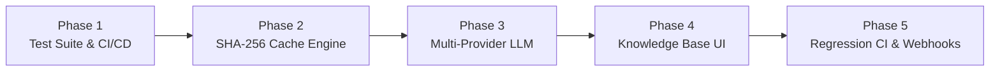

# Final Project Report: AI Response Validation System
**Developed as part of Infosys Springboard Internship 7.0 & Extended Post-Internship Enterprise Evolution**

---

## 1. Problem Statement
As Large Language Models (LLMs) are increasingly integrated into enterprise applications, ensuring the quality, accuracy, and reliability of their outputs has become a critical challenge. LLMs are prone to generating "hallucinations" (plausible but factually incorrect statements), omitting key information, or providing irrelevant responses. There is a pressing need for an automated, scalable validation framework capable of evaluating AI-generated responses against verified reference knowledge across multiple dimensions without relying solely on human review.

---

## 2. Objectives
The primary objective of this project was to design and implement an end-to-end "AI Response Validation System". Key objectives included:
- **Automated Evaluation:** Build a multi-agent system to automatically grade AI responses.
- **Source-Grounded Validation (RAG):** Integrate Retrieval-Augmented Generation (RAG) to ensure evaluations are grounded in verifiable facts.
- **Multi-Dimensional Scoring:** Evaluate responses based on four distinct dimensions: Accuracy, Relevance, Completeness, and Hallucination Detection.
- **Batch Processing:** Support bulk evaluation via CSV uploads without triggering API rate limits.
- **Analytics & Reporting:** Provide visual dashboards and structured PDF reports for quality monitoring over time.
- **Post-Internship Enterprise Evolution:** Elevate the system into an enterprise MLOps platform with multi-model provider support, sub-millisecond deduplication caching, dynamic knowledge base management, and automated CI/CD regression benchmarking with signed webhooks.

---

## 3. System Architecture & Design
The system employs a modern, decoupled architecture:

### 3.1 Frontend (React + Vite)
- **Framework:** React 18, Vite, Lucide React (Icons), Recharts (Analytics), jsPDF (Reports).
- **UI/UX:** A responsive, dark/light theme toggleable interface emphasizing modern glassmorphic design and clear data visualization.
- **Modules:** Single Evaluation Intake, Batch Processing with Quick Filters, History Tracker, Analytics Dashboard, Knowledge Base Explorer, and Benchmarks & CI Dashboard.

### 3.2 Backend (FastAPI + Python)
- **Framework:** FastAPI for high-performance async API endpoints.
- **Database:** SQLite with SQLAlchemy ORM for storing evaluation histories, batch metadata, and golden benchmarks.
- **Orchestration:** LangChain and concurrent thread pools for parallel multi-agent evaluation execution.
- **Security:** Constant-time `X-API-KEY` verification (`hmac.compare_digest`) protecting programmatic and benchmark endpoints.

### 3.3 Reference Knowledge Base (RAG Pipeline)
- **Ingestion:** Extracts text from uploaded documents (PDF, TXT, DOCX, MD).
- **Indexing:** Chunks documents using sliding-window overlapping algorithms and generates embeddings using `sentence-transformers` (`all-MiniLM-L6-v2`).
- **Vector Store:** ChromaDB stores vector embeddings for retrieval.
- **Retrieval:** Semantic search retrieves the top-K most relevant document chunks to act as ground-truth context for the evaluation agents, bounded by collection size to prevent out-of-bounds indexing errors.

### 3.4 Multi-Agent Evaluation Orchestrator (MoE Pattern)
The evaluation engine utilizes a **Mixture of Experts (MoE) pattern**, deploying specialized AI judge agents:
1. **Accuracy Agent:** Compares the AI response strictly against the reference context (1–5 score).
2. **Relevance Agent:** Ensures the response directly answers the user's prompt without going off-topic (1–5 score).
3. **Completeness Agent:** Identifies addressed aspects and missing aspects when compared to context (1–5 score).
4. **Hallucination Detection Agent:** Breaks down responses into individual claims and cross-references each against verified context, flagging unsupported or contradictory statements (1–5 score, where 5 = zero hallucination).
5. **Verdict Agent:** A final aggregator that applies the weighted scoring model, assesses penalty criteria, and determines the final Verdict (PASS, NEEDS IMPROVEMENT, or FAIL).

---

## 4. Evaluation Methodology & Scoring Model
The system uses a weighted scoring model out of 100 points:
- **Accuracy:** 40%
- **Relevance:** 20%
- **Completeness:** 20%
- **Hallucination Detection:** 20%

$$\text{Final Score} = \left(\frac{\text{Accuracy}}{5} \times 40\right) + \left(\frac{\text{Relevance}}{5} \times 20\right) + \left(\frac{\text{Completeness}}{5} \times 20\right) + \left(\frac{\text{Hallucination}}{5} \times 20\right)$$

**Verdict Thresholds:**
- **PASS:** Final Score $\ge 80$ (with no severe hallucination or accuracy failure).
- **NEEDS IMPROVEMENT:** Final Score between $50$ and $79.9$.
- **FAIL:** Final Score $< 50$, OR Hallucination Score $\le 2$, OR Accuracy Score $\le 1$.

*Note: Penalty weights can be adjusted dynamically at runtime via the Analytics Dashboard Config API (`/api/config/weights`).*

---

## 5. Implementation & Testing
### 5.1 Predefined Demonstration Test Scenarios
The system was validated using 7 curated scenarios integrated into the frontend "Load Test Case" button:
- **Scenario A (Perfect Response):** Accurate and complete responses receive $>95$ scores.
- **Scenario B (Dangerous Hallucination):** Responses containing plausible fabricated facts trigger the Hallucination Agent, immediately dropping the verdict to FAIL.
- **Scenario C (Subtle Contradiction):** Minor factual inversions are flagged and penalized.
- **Scenario D (Incomplete Response):** Answers omitting critical caveats are identified by the Completeness Judge.
- **Scenario E (Irrelevant / Off-Topic):** Responses failing to address the core prompt are penalized by the Relevance Judge.
- **Batch Evaluation:** Uploaded CSVs containing 50+ mixed-quality responses processed via the Consolidated Master Prompt without hitting API rate limits.

### 5.2 Performance & Scalability
- Async FastAPI backend ensures the UI remains non-blocking during heavy LLM evaluation calls.
- SQLite successfully handles thousands of evaluation records using `.yield_per(100)` streaming generators to eliminate memory bloat during CSV/JSON exports.

---

## 6. Pre-Submission Enhancements & Milestones 1–4 Recap
Prior to initial internship submission, the foundational milestones were delivered:
1. **Configurable Scoring Weights Engine:** Real-time sandbox to adjust penalty weights with global persistence.
2. **GitHub-Style Heatmap Calendar:** 365-day contribution heatmap graph mapped to historical evaluations.
3. **Agent Confidence Badging:** Real-time linguistic parser identifying hedging language ("might", "perhaps") to tag evaluations with High, Medium, or Low confidence.
4. **Sentence Heatmap & Bidirectional Grounding:** Visualizing supported vs hallucinated claims with cross-textarea sentence illumination.
5. **Multi-Stage Docker Containerization:** Single-port (8005) deployment bundling Vite React and FastAPI for seamless cloud hosting on Render.com.

---

## 7. Post-Internship Enterprise Engineering Evolution (Phases 1–5)

Following the formal internship submission, a second engineering initiative was executed to transform the system into an enterprise MLOps platform:

### 7.1 Phase 1: Automated Test Suite & CI/CD Hardening
- **GitHub Actions Pipeline ([`.github/workflows/ci.yml`](../.github/workflows/ci.yml)):** Automated CI gating every commit with Ruff linting, test execution, and Docker build checks.
- **Pytest Infrastructure ([`tests/conftest.py`](../tests/conftest.py)):** In-memory SQLite session with mock LLM fixtures for deterministic offline testing.
- **78 Automated Tests:** Expanded test coverage from 1 file to 78 tests across agents, API endpoints, caching, retrieval, vector store, and webhook delivery.
- **Ruff Linter:** Enforced clean Python code standards with 0 errors across the codebase.

### 7.2 Phase 2: Deterministic SHA-256 Caching Engine
- **Input Hashing ([`backend/core/cache.py`](../backend/core/cache.py)):** Canonical SHA-256 hash computed over normalized prompt, response, reference, and context.
- **Instant Replay:** Cache hits bypass LLM API calls completely, cloning previous evaluation records in $<5\text{ms}$ and conserving API quotas.
- **Telemetry Integration:** Live tracking of `cache_hit_rate` percentage in the Analytics Dashboard.

### 7.3 Phase 3: Model-Agnostic Multi-Provider LLM Layer
- **Unified Provider Abstraction ([`backend/core/providers/factory.py`](../backend/core/providers/factory.py)):**
  - **Groq Cloud:** High-speed cloud inference (`openai/gpt-oss-120b`).
  - **Ollama:** Offline local inference (`llama3.2:3b`, `mistral`) for privacy-critical and air-gapped deployments.
  - **OpenAI:** OpenAI API and OpenAI-compatible endpoints (vLLM, Together AI, LocalAI).
- **Automatic Runtime Failover:** Seamless failover to `LLM_FALLBACK_PROVIDER` when primary provider retries are exhausted.
- **Provider Status API:** `GET /api/provider/status` for monitoring active models and latency.

### 7.4 Phase 4: Dynamic Knowledge Base Management UI & Ingestion Pipeline
- **Sliding-Window Sentence Chunker ([`backend/kb/chunking.py`](../backend/kb/chunking.py)):** Ingestion for PDF, DOCX, TXT, and Markdown files with configurable chunk overlap.
- **Management API Endpoints:** Complete CRUD and vector search suite (`/api/kb/status`, `/api/kb/documents`, `/api/kb/upload`, `/api/kb/search`, `/api/kb/documents/{doc_id}`).
- **Interactive UI Tab ([`frontend/src/KnowledgeBase.jsx`](../frontend/src/KnowledgeBase.jsx)):** Drag-and-drop document upload zone and a semantic search playground displaying cosine similarity distance metrics.

### 7.5 Phase 5: Automated Regression Benchmarking & Webhook CI Integration
- **HMAC-SHA256 Signed Webhooks ([`backend/core/webhook.py`](../backend/core/webhook.py)):** `POST /api/evaluate/batch` accepts `callback_url` and `webhook_secret`. Delivers signed POST requests (`X-ARVS-Signature: sha256=<hex>`) upon batch completion. Plaintext secrets are never stored (hashed via SHA-256 for audit tracking).
- **Golden Benchmarks Table & Migration ([`scripts/migrate_benchmarks.py`](../scripts/migrate_benchmarks.py)):** Idempotent database migration script establishing the `golden_benchmarks` catalog.
- **Regression Delta Engine:**
  - `POST /api/benchmarks`: Snapshot any completed batch as a baseline.
  - `POST /api/benchmarks/{id}/compare`: Compares candidate batches against baselines, calculating per-dimension metric deltas.
  - **Automated Verdict:** Generates `REGRESSION_DETECTED` when pass rate drops by $>5$ percentage points or key metrics degrade; returns `IMPROVED` or `STABLE` otherwise.
- **API Security:** Constant-time `X-API-KEY` authentication (`hmac.compare_digest`) protecting programmatic endpoints against timing attacks.
- **Frontend Dashboard ([`frontend/src/Benchmarks.jsx`](../frontend/src/Benchmarks.jsx)):** Interactive "Benchmarks & CI" tab with baseline catalog, comparison runner, and color-coded delta reports.

---

## 8. Verification & Quality Metrics Summary

| Quality Dimension | Standard Enforced | Verification Result |
| :--- | :--- | :---: |
| **Unit & Integration Tests** | 100% passing offline test suite | **78 / 78 Passed** |
| **Python Code Quality** | PEP 8, Ruff static analysis | **0 Errors** |
| **Frontend Code Quality** | React 18, ESLint with FlatConfig | **0 Errors** |
| **Regression Gating** | Drop $>5\%$ triggers `REGRESSION_DETECTED` | **Verified** |
| **Webhook Security** | HMAC-SHA256 constant-time comparison | **Verified** |
| **API Key Protection** | Constant-time `hmac.compare_digest` | **Verified** |
| **Container Portability** | Multi-stage Docker on unified port 8005 | **Verified** |

---

## 9. Conclusion
The **AI Response Validation System** successfully achieved all academic and functional milestones set by the **Infosys Springboard Internship 7.0**. Through subsequent post-internship engineering, the system was fortified into an enterprise-grade MLOps platform capable of serving as an automated quality gate in continuous integration pipelines for Large Language Models.

---
*Report Documented by Mohammed Hassan — AI Response Validation System Project.*
